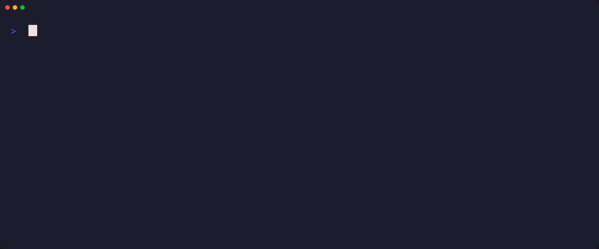
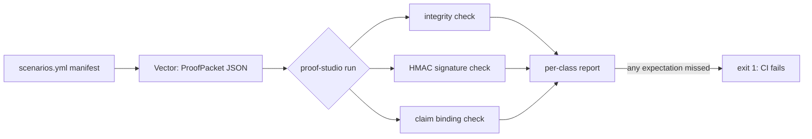

# proof-studio

> The tamper-scenario and benchmark studio around rigforge: author forged-proof attacks, run them against the real verifier, see what each attack class catches.



[](https://github.com/mrodgersjs-web/proof-studio/actions/workflows/ci.yml)


**[rigforge](https://github.com/mrodgersjs-web/rigforge) is the core library** (vendored here under `packages/rigforge`): it seals finished AI-agent work into HMAC-signed `ProofPacket` records and verifies them. proof-studio is the studio around that core: it authors tamper scenarios, runs them against the real verifier, and reports per attack class what gets caught.

## Why this exists

A verifier that cannot fail is theater. Anyone can claim their "done" check is tamper-proof; this repo makes the claim executable. Planted forgeries (swapped artifact hash, forged signature, replayed packet) are built as real ProofPacket files by deterministic builders, `proof-studio run` verifies each one under the strict policy, and CI fails the moment a planted forgery stops going red. The scenario set is yours to edit: add the attack you are worried about and make the verifier prove it fails.

## What it proves

Every row is a command you can run yourself. Results measured 2026-10-19 on a fresh `pip install -e '.[dev]'`:

| Check | Command | Measured result |
| :-- | :-- | :-- |
| Planted forgeries are caught | `proof-studio run` | 3/3 forgeries rejected: tampered hash (signature fails), forged signature, replay (claim binding fails); 1/1 control accepted |
| Catch rates | `proof-studio run` | false-done-caught rate 1.00, false-pass rate 0.00, accuracy 1.00 |
| The gate can fail | `pytest -q` | a mislabelled expectation reports MISMATCH and `proof-studio run` exits 1 (proven by tests) |
| Vectors are reproducible | `proof-studio build-vectors` | two generations are byte-identical (proven by tests) |
| Test suite | `pytest -q` | 31 passed, 0 skipped |
| Smoke path | `bash scripts/smoke.sh` | `proof-studio smoke PASS` |

If a check cannot fail, it is theater.

## Quickstart

```bash
git clone https://github.com/mrodgersjs-web/proof-studio.git && cd proof-studio
python3 -m venv .venv && source .venv/bin/activate
pip install -e '.[dev]'
proof-studio run
```

Real output:

```
scenario                     kind                     expect  actual  result           detail
--------------------------------------------------------------------------------------------------------------
clean_build.json             control                  accept  accept  OK clean         all checks passed
tampered_artifact_hash.json  tampered_artifact_hash   reject  reject  OK caught        rejected on: signature
forged_signature_no_key.json forged_signature         reject  reject  OK caught        rejected on: signature
replay_attack.json           replay                   reject  reject  OK caught        rejected on: claim binding

false-done-caught rate 1.00
accuracy               1.00

ALL EXPECTATIONS MET
```

## How it works



Each scenario names one vector file plus the claim it is submitted against and the verdict the verifier must reach. The strict policy accepts only when integrity, HMAC signature, and claim binding (phase and name) all pass.

## What each attack class defeats

| Class | What the vector does | Check that catches it |
| :-- | :-- | :-- |
| `control` | Honest packet, sealed with the demo key | none needed: must be accepted |
| `tampered_artifact_hash` | Artifact hash swapped after sealing, packet hash re-forged to hide it | naive integrity passes; the HMAC signature fails |
| `forged_signature` | Signature produced without the real signing key | signature check |
| `replay` | Genuine packet for one claim re-submitted as proof of a newer claim | claim binding (phase and name are inside the signed hash) |

**Replay limits (honest scope).** Claim binding rejects a valid packet placed in a phase slot it was not sealed for. It does not yet catch two other replays, because the signed packet carries no project id and no nonce: a packet copied from another project that shares a signing key, and an older valid packet from an earlier run of the same phase and name. Use a separate signing key per project and keep proofs under version control.

## Project layout

| Path | What lives there |
| :-- | :-- |
| `proof_studio/` | Scenario model, deterministic vector builders, runner, report, CLI |
| `tests/failures/` | The scenario manifest; the vectors are generated here (gitignored, reproducible) |
| `tests/` | The studio's own suite (runner, CLI, packaging, README truth lint) |
| `packages/rigforge/` | Vendored core library: ProofPacket seal and verify, CLI, benchmark |
| `mcp/` | Optional results MCP server |
| `docs/` | Architecture, evaluation strategy, public boundary |

## Development

```bash
pip install -e '.[dev]'    # installs the studio; the core is used from packages/rigforge
pytest -q                  # 31 passed, 0 skipped (measured 2026-10-19)
ruff check .
proof-studio run           # the gate CI runs: every planted failure must go red
```

Add an attack: extend `proof_studio/scenarios.py` with a builder, add a row to `tests/failures/scenarios.yml`, and run `proof-studio run`. See [`CONTRIBUTING.md`](CONTRIBUTING.md).

## Public boundary

The demo signing key is derived from a literal string and is not a secret. This repo ships no customer data, no production signing keys, and no private fleet credentials. See [`docs/public-boundary.md`](docs/public-boundary.md).

## Security

HMAC signatures are symmetric, which limits who can verify. Read [`SECURITY.md`](SECURITY.md) for the limitation and how to report an issue (security@rodgersintelligence.com).

## License

MIT, see [`LICENSE`](LICENSE).

---

<sub>Built by Mike Rodgers · [rodgersintelligence.com](https://rodgersintelligence.com)</sub>
